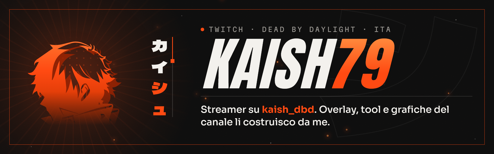

Ciao, sono **Kaish**. Faccio dirette di **Dead by Daylight** su Twitch, in italiano, e tutto quello che vedi in onda l'ho costruito io: schermate, scena live, alert, comandi per la chat, grafiche del profilo e lo Stream Deck che le comanda.

*Italian Dead by Daylight streamer on Twitch. I build my own stream overlays, chat tools and channel graphics.*

### Cosa c'è dietro il canale

**Kagune V6, l'identità grafica del canale.** Nero, bianco osso e un solo accento arancio; Anton per i titoli, Martian Mono per le etichette, Sora per i testi; Kaneki come marchio. Starting soon con countdown, pausa, chiusura con i titoli di coda, scena live con cornici per gioco e cam, banner, pannelli e schermata offline: tutto in HTML e SVG, servito in locale e letto da OBS, quindi ogni modifica è in onda appena salvo il file.

**Overlay che parlano con la chat.** Collegati a Streamer.bot via WebSocket: il benvenuto al primo messaggio, gli shoutout, il brano Spotify in riproduzione con le richieste `!sr`, il voto sul killer e il sorteggio dei perk decisi dalla chat, e il punto canale «Zitto, devo parlare» con un generatore di frasi che gira come una slot.

**Strumenti per Dead by Daylight.** Le callout map delle mappe ridisegnate in SVG (57, partendo da quelle di hens333) per indicare i punti in partita, e la dashboard della challenge *free-to-play hardcore* con il suo overlay.

**Stream Deck generato da script.** Il profilo «Kaish V6» per lo Stream Deck MK.2: tasti, cartelle e azioni descritti in un file JSON, icone generate in Python, installazione con backup e ripristino in un comando.

### La community

- **[DBD Builds](https://dbd-builds.it)**: build e wiki di Dead by Daylight in italiano, il sito della community, sviluppato da [heyatomdev](https://github.com/heyatomdev).
- **[Approdo nella Nebbia](https://discord.gg/approdo)**: il server Discord, per organizzare partite e parlare del gioco anche quando non sono in diretta.

### Con cosa lavoro

HTML, CSS e JavaScript senza framework per tutto quello che va in OBS (il browser di OBS è un Chromium datato, quindi niente scorciatoie moderne) · Python per script, piccoli server locali ed esportazione dei PNG con Chrome headless e Pillow · C# per le azioni di Streamer.bot · OBS Studio, Streamer.bot, Stream Deck.

### Dove trovarmi

[Twitch](https://www.twitch.tv/kaish_dbd) · [YouTube](https://www.youtube.com/@Kaish_DBD) · [Instagram](https://www.instagram.com/kaish_1979/) · [Discord](https://discord.gg/approdo) · [DBD Builds](https://dbd-builds.it)

Il codice dei progetti è privato: il risultato lo vedi in diretta.
